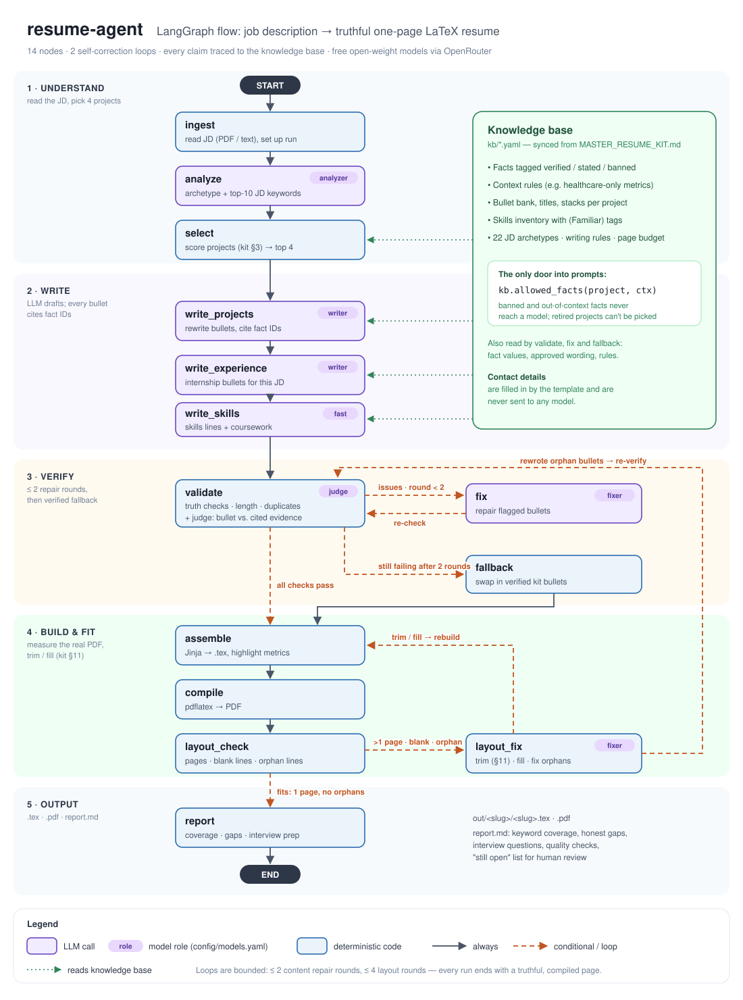

# resume-agent

A LangGraph pipeline that turns a job description into a one-page, JD-tailored LaTeX resume and cover letter. Every claim on the page must trace back to a verified fact in a knowledge base, and **code** enforces that, not prompt instructions.

It automates the workflow in [`MASTER_RESUME_KIT.md`](../../MASTER_RESUME_KIT.md): the kit's rules (§2), workflow (§3), facts (§5–§8), template (§12) and QA checklist (§13) become data, graph nodes and validators.



<details>
<summary>Mermaid version (generated from the compiled graph)</summary>

See [`docs/graph.mmd`](docs/graph.mmd). Regenerate both the Mermaid file and the PNG with `python scripts/export_graph.py`.
`tests/test_docs.py` fails if a graph node is added without updating the diagram.
</details>

## Status

| Phase | What | Status |
|---|---|---|
| 0 | Knowledge base as data + truth guards + template | ✅ done |
| 1 | Linear LangGraph MVP (ingest → analyze → select → write → assemble → compile → report) | ✅ done |
| 2 | Validators + self-correction loop + LLM judge + layout loop | ✅ done |
| 3 | Human-in-the-loop interrupts + SQLite checkpointer + application tracker | — |
| 4 | Cover-letter subgraph | — |
| 5 | Eval on the golden set (`../../resumes/`) + tracing | — |
| 6 | Streamlit UI, batch mode | — |

## Run

```bash
python -m resume_agent run --jd "../../JD ML and Data Science Intern- KA.pdf" --company KA --role "ML & Data Science Intern"
# -> out/<slug>/<slug>.tex, .pdf, report.md   (add --save-to-kit to copy the .tex into Resume_Builder/resumes/)
```

Any model bullet that fails a truth check is replaced by a verified bank bullet and listed in `report.md`.

The JD analysis is cached in `cache/` (gitignored), keyed by the JD text, prompt and analyzer model, so re-running
the same JD skips that call. Pass `--fresh` to re-analyse.

## Cost

About 1 cent per resume before the 4 Nov cuts. LangSmith traces showed the fixer used ~65% of paid tokens, mostly
re-trying bullet lengths it rarely got right. The fixes:

- **Lengths are fixed at the source.** The writer sees each reference bullet's `chars` and is asked to stay within
  ~10 of it. A draft that still lands in the dead zone (106–179 chars, or over 215) is swapped for a verified,
  well-sized kit bullet citing the same facts, with no model call.
- **One fixer attempt per length problem.** If it misses, a kit bullet is used (or, if only soft, the bullet is kept).
- **Smaller fixer payloads.** Facts and rules go once per project, not once per bullet. Prompts use compact JSON.
- **JD analysis cache** (see above).

The judge runs on a free endpoint, so its tokens cost nothing.

## Tracing (LangSmith)

Add `LANGSMITH_API_KEY=lsv2_...` to `.env` and every run is traced automatically (`--no-trace` to skip):

- one trace per resume, named `resume:<slug>` and tagged with the company,
- each graph step as a child run, and inside it every model call named by role
  (`writer:ProjectDraft`, `judge:Verdicts`, `fixer:FixBatch`, …) with latency, tokens and the model that answered,
- the 4 parallel project calls nested under `write_projects` (context is carried into worker threads).

Benchmarks are not traced unless you pass `--trace` (they go to the `resume-agent-development` project; normal runs go to `resume-agent-local`).
Prompts contain the job description and project facts, never contact details.

## Design rule

**LLMs decide and write; code checks and assembles.**

- **LLM:** JD analysis, keyword ranking, rewording bullets, cover-letter prose.
- **Python:** project scoring (kit §3), fact gating, number checks, banned phrases, LaTeX assembly, compile, page count.
- **Privacy:** contact details never go to an LLM. The template fills them in from `kb/profile.yaml`.

## Layout

```
kb/                      ← the kit as data (source: MASTER_RESUME_KIT.md v2)
  meta.yaml              kit version this KB was synced from
  profile.yaml           §4    contact, education, coursework, taglines
  experience.yaml        §5    research intern facts + bullet groups A–E
  skills.yaml            §6    "(Familiar)" tags preserved
  projects/*.yaml        §7    11 projects: facts (verified/stated/banned), titles, bullet bank
  achievements.yaml      §8
  archetypes.yaml        §9    22 JD types → projects + experience groups
  rules.yaml             §2, §10, §11  banned phrases, analogy regexes, verbs, page budget
  retired.yaml           App. F
resume_agent/
  knowledge/models.py    Pydantic schema + query helpers (allowed_facts, allowed_bullets, …)
  knowledge/loader.py    load + cross-reference validation
  knowledge/numbers.py   pulls quotable numbers out of text (skips ResNet-18, F0.5, C++17, years …)
  knowledge/checks.py    bullet truth checks (reused by the Phase 2 validator)
  latex.py               escaping + Jinja env with LaTeX-safe delimiters
  llm.py                 role-based OpenRouter models (Phase 1+)
templates/resume.tex.j2  kit §12, preamble/spacing frozen
config/models.yaml       free OpenRouter models per role, with fallbacks
scripts/list_free_models.py
tests/
```

## How facts are gated

Each fact carries a `status` and optional restrictions:

```yaml
- id: mv_sens_spec
  claim: "92.3% sensitivity, 91.0% specificity ..."
  values: ["92.3", "91.0", "94.5", "87.6"]   # the only numbers a bullet citing this may use
  status: verified                            # verified ✅ | stated ⚠ | banned ⛔
  eval_size: 624                              # <50 → must be banned (kit §2.4.4)
  allowed_when: {archetypes: [healthcare]}    # kit §2.5
```

`kb.allowed_facts(project, Context(archetype=..., company=...))` is the only door the graph will use. Banned facts, out-of-context facts and retired projects never come through it.

A bullet passes `check_bullet` only if:
- every number in it appears in a fact it cites,
- it has no banned phrase or term, analogy clause, IIT/IIM implication, unconfirmed claim, lead verb on a team project, or "% vs pts" mix-up.

## Setup

```bash
pip install -e ".[dev]"          # Phase 0
pip install -e ".[agent,dev]"    # Phase 1+ (langgraph, langchain-openai, pypdf)
cp .env.example .env             # add OPENROUTER_API_KEY
python -m pytest                 # 88 tests; compile test needs pdflatex (MiKTeX)
python scripts/list_free_models.py --check
```

## Keeping the KB in sync with the kit

The kit stays the human-readable source. When you change `MASTER_RESUME_KIT.md`:
1. Update the matching YAML (e.g. a ⚠ fact becomes ✅ after Appendix C Fix 4: change `status: stated` to `verified` and add `source`).
2. Set `kb/meta.yaml → kit_updated` to the kit's new `*Last updated:` date.

`tests/test_kit_sync.py` fails until step 2 is done, and also checks that every GitHub URL in kit §7 is present in the KB.

## Models (OpenRouter)

Defined in `config/models.yaml`, chosen by measurement on 2026-11-04. The reasons and trial numbers are in that file.

| Role | Primary | Why |
|---|---|---|
| analyzer, writer, fixer, fast | `mistralai/mistral-small-3.2-24b-instruct` (paid, cheap) | ~8–10 s/call, passes the truth checks |
| judge | `nvidia/nemotron-3-ultra-550b-a55b:free` | best on the seeded-error benchmark (97.9% caught, 2.0% false flags) |

Each role has fallbacks, which OpenRouter tries automatically. Free models disappear without notice, so run `--check` before a batch.
